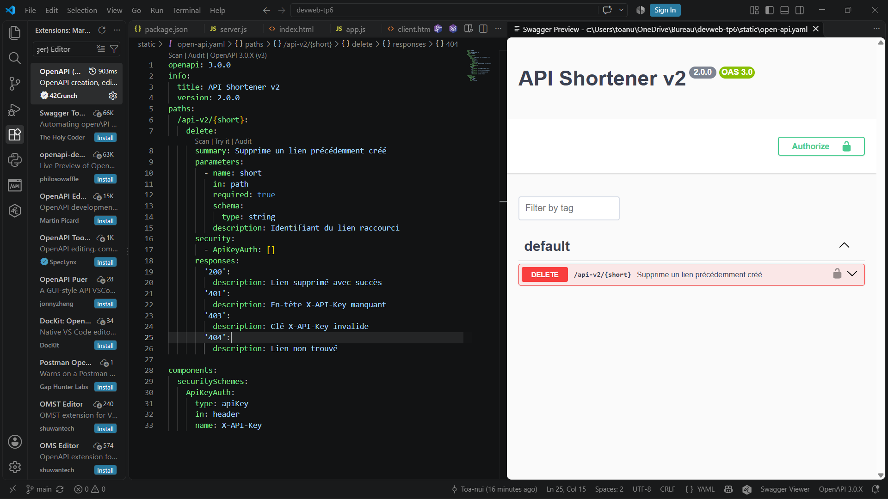
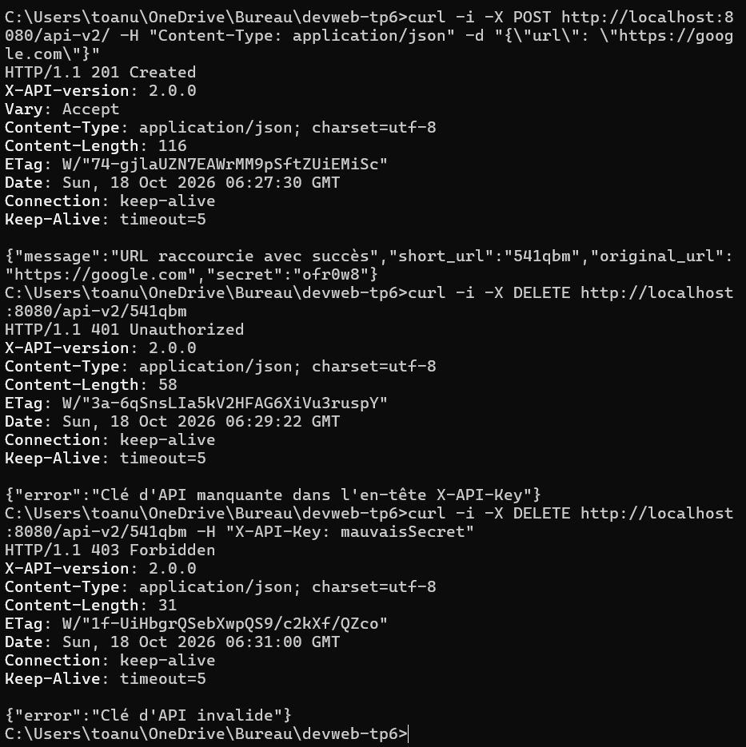
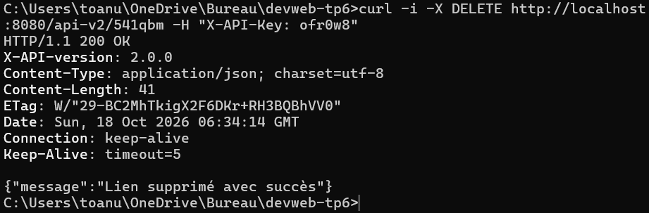

...

Tutoriel HTTP/Express Node.js

Partie 1: serveur HTTP natif Node.js

Question 1.1 :

Dans la page de mon serveur faire (fn + f12) puis aller dans "Network" "Name"->"localhost" (le nom de notre serveur en gros) et dans les "Headers". La liste des en-têtes de la réponse HTTP du serveur est :

(   Connection : keep-alive
    Date : Fri, 18 Sep 2026 22:16:45 GMT
    Keep-Alive : timeout=5
    Transfer-Encoding : chunked )

Question 1.2 : 

Après modification de la fonction requestListener(), la liste des en-têtes est :

(   Connection : keep-alive
    Content-Length : 20
    Content-Type : application/json
    Date : Fri, 18 Sep 2026 22:28:45 GMT
    Keep-Alive : timeout=5 )

Question 1.3 :

La réponse reçue par le client contient le code HTTP "200 OK", l'en-tête Content-Type: text/html et dans son corps, le contenu du fichier index.html. Le navigateur interprète alors ce contenu comme une page HTML et l'affiche.

Question 1.4 :

L’erreur affichée est ENOENT (no such file or directory). Elle indique que le fichier index.html n’a pas été trouvé dans le répertoire depuis lequel le serveur est exécuté.

{
    errno: -4058, (en jaune)
    code: 'ENOENT', (en  vert)
    syscall: 'open', (en vert)
    path: 'C:\\Users\\toanu\\OneDrive\\Bureau\\devweb-tp5\\index.html' (en vert)
}

Question 1.5 :

Le code ci-dessous représente la fonction requestListener() modifier avec la gestion d'erreur 500 si le fichier index.html est introuvable, tout ça en async/await.

"""
    async function requestListener(_request, response) {
    try {
        const contents = await fs.readFile("index.html", "utf8");

        response.setHeader("Content-Type", "text/html");
        response.writeHead(200);
        response.end(contents);
    } catch (error) {
        console.error(error);
        response.writeHead(500);
        response.end("Erreur interne du serveur");
    }
    }
"""

Question 1.6 :

Ces commandes ont modifié le fichier package.json en ajoutant cross-env dans les dépendances et nodemon dans les dépendances de développement.

"""
    "devDependencies": {
        "nodemon": "^3.1.14"
    },
    "dependencies": {
        "cross-env": "^10.1.0"
    }
"""

Elles ont aussi créé le fichier package-lock.json et installé pleins de paquets dans le dossier node_modules également créé.

Question 1.7 :

Le script http-dev lance le serveur avec nodemon et définit NODE_ENV à development. Grâce à nodemon, le serveur redémarre automatiquement lorsque le fichier server-http.mjs est modifié.

{
    C:\Users\toanu\OneDrive\Bureau\devweb-tp5>npm run http-dev

    > devweb-tp5@1.0.0 http-dev
    > cross-env NODE_ENV=development nodemon server-http.mjs

    [nodemon] 3.1.14
    [nodemon] to restart at any time, enter `rs`
    [nodemon] watching path(s): *.*
    [nodemon] watching extensions: js,mjs,cjs,json
    [nodemon] starting `node server-http.mjs`
    Server is running on http://localhost:8000
    [nodemon] restarting due to changes...
    [nodemon] starting `node server-http.mjs`
    Server is running on http://localhost:8000
    NODE_ENV = development
}

Le script http-prod définit NODE_ENV à production et lance le serveur avec node directement. Il n'y a donc pas de rechargement automatique lorsque le fichier est modifié.

{
    C:\Users\toanu\OneDrive\Bureau\devweb-tp5>npm run http-prod

    > devweb-tp5@1.0.0 http-prod
    > cross-env NODE_ENV=production node server-http.mjs

    Server is running on http://localhost:8000
    NODE_ENV = production
}

Ainsi, http-dev est destiné au développement, tandis que http-prod est destiné à l'exécution en production; Lance avec nodemon = Rechargement automatique -> oui, Lance avec node = Rechargement automatique -> non. Donc le rôle de cross-env est ici de définir NODE_ENV de manière compatible selon le système d'exploitation.

Question 1.8 :

Avec cette fonction requestListener(), les codes HTTP sont déterminés par le switch sur request.url.

{
    /index.html       → 200 OK
    /random.html      → 200 OK
    /                 → 404 NOT FOUND
    /dont-exist       → 404 NOT FOUND
}

Le 500 n'est pas obtenu avec ces quatre routes dans le fonctionnement normal, car il correspond uniquement au catch, par exemple si index.html est introuvable.

...

Partie 2: framework Express

Question 2.1 :

Ces liens ci-dessous correspondent bien aux documentations des modules installés par la commande.

(
    Express : https://expressjs.com/
    http-errors : https://www.npmjs.com/package/http-errors
    loglevel : https://www.npmjs.com/package/loglevel
    morgan : https://expressjs.com/fr/resources/middleware/morgan/
)

Question 2.2 :

Les trois routes fonctionnent :

(
1   http://localhost:8000/ → affiche ce qu'il y a dans la balise h1.
2   http://localhost:8000/index.html → affiche ce qu'il y a dans la balise h1.
3   http://localhost:8000/random/5 → affiche une liste de 5 nombres aléatoires compris entre 0 et 99 à chaque rafraichissement de la page.
)

Question 2.3 :

Pour le 1 (rappel de la question précédente pour 1 ; 2 et 3), le Status Code affiche 304 (Not Modified) ainsi que :

{
    Accept-Ranges: bytes
    Cache-Control: public, max-age=0
    Connection: keep-alive
    Date: Mon, 21 Sep 2026 04:10:24 GMT
    Etag: W/"7b-1a0c1e390dc"
    Keep-Alive :timeout=5
    Last-Modified: Mon, 21 Sep 2026 02:55:11 GMT
    X-Powered-By: Express
}

Pour le 2 (rappel de la question précédente pour 1 ; 2 et 3), le Status Code affiche 304 (Not Modified) ainsi que :

{
    Accept-Ranges: bytes
    Cache-Control: public, max-age=0
    Connection: keep-alive
    Date: Mon, 21 Sep 2026 04:10:43 GMT
    Etag: W/"7b-1a0c1e390dc"
    Keep-Alive: timeout=5
    Last-Modified: Mon, 21 Sep 2026 02:55:11 GMT
    X-Powered-By: Express
}

Et pour le 3 (rappel de la question précédente pour 1 ; 2 et 3), le Status Code affiche 200 (OK) ainsi que :

{
    Connection: keep-alive
    Content-Length: 81
    Content-Type: text/html; charset=utf-8
    Date: Mon, 21 Sep 2026 04:10:57 GMT
    Etag: W/"51-sL2RrLs+z9TWhJQZjMXAXLDmBzE"
    Keep-Alive: timeout=5
    X-Powered-By: Express
}

Donc par rapport au serveur HTTP précédent, X-Powered-By: Express est le nouvel en-tête ajouté par Express. Express automatise également certains en-têtes comme Content-Length, Content-Type et ETag.

Question 2.4 :

L'événement listening est déclenché lorsque le serveur a réussi à démarrer et est prêt à accepter des connexions sur le port indiqué. Ici, il est déclenché lorsque le serveur est en écoute sur le port 8000.

Question 2.5 :

L’option activée par défaut est redirect du middleware express.static(). Elle permet notamment de rediriger une URL correspondant à un répertoire vers une URL terminée par /. Express.static("static") sert index.html automatiquement pour /, grâce à l’option index, qui vaut "index.html" par défaut. Ce n’est pas redirect qui fait / → /index.html. Donc l’option activée par défaut qui permet de servir index.html lorsque l’on demande / est index, dont la valeur par défaut est "index.html".

Question 2.6 :

Lors de la première visite, style.css retourne 200 OK, car le fichier est téléchargé. Avec Ctrl + R, le navigateur utilise le cache et vérifie si le fichier a changé grâce à l'ETag : le serveur répond 304 Not Modified si le fichier n'a pas été modifié. Avec Ctrl + Shift + R, le cache est ignoré et le fichier est téléchargé à nouveau : 200 OK.

General;

{
    Request URL: http://localhost:8000/style.css
    Request method: GET
    Status code: 200 OK
    Remote address: [::1]:8000
    Referrer policy: strict-origin-when-cross-origin
}

Response headers;

{
    Accept-Ranges: bytes
    Cache-Control: public, max-age=0
    Connection: keep-alive
    Content-Length: 0
    Content-Type: text/css; charset=utf-8
    Date: Mon, 21 Sep 2026 05:19:19 GMT
    Etag: W/"0-1a0c2590bdc"
    Keep-Alive: timeout=5
    Last-Modified: Mon, 21 Sep 2026 05:03:30 GMT
    X-Powered-By: Express
}

Question 2.7 :

En mode development, la page d'erreur affiche le code HTTP, le message et la stack trace de l'erreur.

En mode production, la page affiche uniquement le code HTTP et le message, sans la stack trace. Cela permet de ne pas exposer les informations internes du serveur aux utilisateurs en production.

Conclusion :

Avec le niveau DEBUG, les messages de niveau DEBUG, INFO, WARN et ERROR sont affichés. Avec le niveau WARN, les messages DEBUG et INFO ne sont plus affichés ; seuls les messages WARN et ERROR le sont. Le niveau de verbosité permet donc de contrôler la quantité de messages affichés dans la console.

...

Réducteur d'URL en Node.js / Express

Ce projet est réalisé dans le cadre du cours de développement web. Il s'agit d'un service complet de réduction d'URL (type Bitly / TinyURL) avec API REST, base de données SQLite et client web.

Fonctionnalités & Avancement

- [x] Partie 1 : Prise en main & initialisation

  - Configuration d'Express, des variables d'environnement ('.env') et des scripts npm.
  - Implémentation des middlewares ('X-API-version', désactivation de 'X-Powered-By', gestion de 'favicon.ico').
  - Implémentation des routes de base sous '/api-v1/' ('GET /', 'POST /', 'GET /error', réponses 501 pour les routes non encore développées).
  - Réponses rédigées dans le fichier 'REPONSES.md'.

- [x] Partie 2 : API v1 (Base de données SQLite)

  - Factorisation de la configuration dans 'config.js'.
  - Connexion SQLite et création automatique de la table dans 'database/database.js'.
  - Implémentation complète de l'API v1 dans 'router/api-v1.js' (raccourcissement, comptage des visites, statut et redirection HTTP 302).

- [x] Partie 3 : HTML & Négociation de contenu (API v2)
  - Support de 'res.format()' pour répondre en JSON ou HTML selon l'en-tête 'Accept'.
  - Intégration du moteur de rendu 'ejs' et création de la vue 'views/root.ejs'.
  - Implémentation du routeur '/api-v2/' avec gestion des formulaires et redirection.

- [x] Partie 4 : Client AJAX (tag: client-ajax)
 - Implémentation de l'interface client SPA dans 'static/index.html' et 'static/client.html'.
 - Communication asynchrone avec l'API v2 via 'fetch()' dans 'static/app.js'.
 - Intégration de l'API Clipboard pour la copie rapide des liens raccourcis.

- [x] Partie 5 : Suppression & Authentification (tag: api-v2-delete)
 - Ajout du champ 'secret' en base de données SQLite pour l'authentification des liens.
 - Création de la route 'DELETE /api-v2/:url' sécurisée via l'en-tête 'X-API-Key' (codes HTTP 200, 401, 403, 404).
 - Exclusion du champ 'secret' lors des réponses JSON sur la route 'GET /api-v2/:url'.
 - Création de la documentation OpenAPI dans 'static/open-api.yaml' avec support du schéma de sécurité 'ApiKeyAuth'.

## Démonstration et Tests

### Interface Swagger OpenAPI

### Tests des routes avec curl

 